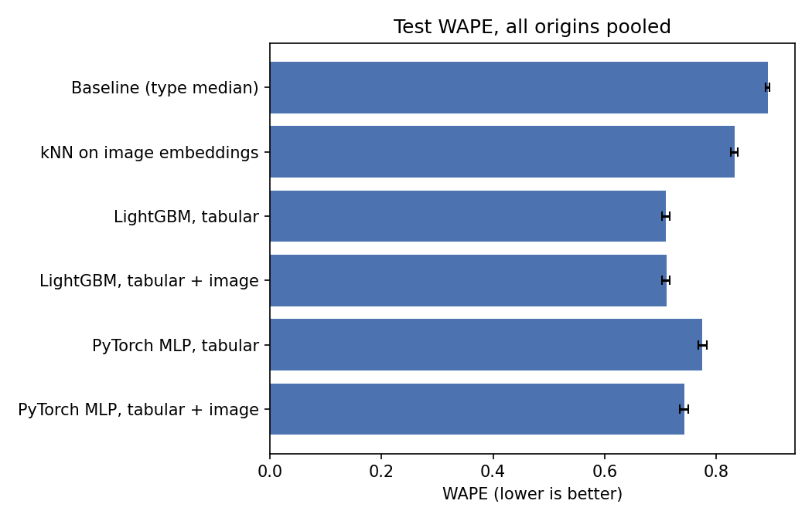

# Cold-start demand prediction for new fashion articles


**Question.** A fashion article has no sales history when it launches, and last year's similar
products are a poor guide because trends change. How many units will it sell in its first four
weeks, given its attributes and its picture?

This repository compares a type-median baseline, a visual nearest-neighbour baseline, gradient
boosting (with assortment, text and visual-neighbour features) and a small neural network on the
public H&M data, with an evaluation designed to avoid
the usual leaks: split by product launch date, embargo, colour variants kept together, and
confidence intervals that resample whole products.

It is a regression on a cross-section of launches, not time-series forecasting. Time only enters
through the train/test split.

## Data

[H&M Personalized Fashion Recommendations](https://www.kaggle.com/competitions/h-and-m-personalized-fashion-recommendations)
(Kaggle): transactions from September 2018 to September 2020, the article table and the product
images. The data is not redistributed here; accept the competition rules on Kaggle to use it.

**Target.** Units sold during the first 4 weeks after an article's first sale. Articles already
on sale when the data starts are dropped (their true launch is unknown), as are articles whose
first four weeks are not fully observed.

## Models

| Model | Inputs |
|---|---|
| Baseline | Median units of the product type |
| kNN | Median units of the 10 visually closest training articles (cosine distance on ResNet50 embeddings) |
| LightGBM, tabular | 9 categorical attributes, price, launch month and week; L1 objective |
| LightGBM, tabular + image | Same, plus a 32-component PCA of the image embedding |
| LightGBM, + assortment | Tabular, plus launch-context features: variants in week 1, price relative to the type, launches that week (all and same section), month sine/cosine |
| LightGBM, + assortment + text | Same, plus a 16-component SVD of TF-IDF on the product description |
| LightGBM, + all + visual neighbours | Same, plus target features from the visually closest training articles (median, mean log, distance), computed leave-product-out |
| PyTorch MLP, tabular | Learned embeddings for the categories plus numeric features; L1 loss on `log1p(units)` |
| PyTorch MLP, tabular + image | Same, plus a dropout + linear branch on the image embedding |

Image embeddings come from a ResNet50 pretrained on ImageNet, used as a frozen feature extractor.

## Evaluation protocol

- **Split by product launch date.** Test products launch after a cutoff; training products launch
  at least four weeks before it, and so do all their colour variants, so every training target is
  fully observed before the cutoff.
- **Colour variants stay together.** Variants share a `product_code` and are never split between
  train and test. A test article therefore never finds its own variants among its visual
  neighbours.
- **Rolling origin.** Three cutoffs (50th, 65th and 80th percentile of launch dates). The test
  window of an origin ends where the next one starts, so no article is tested twice.
- **Validation.** The latest 15% of the training products are used only for early stopping.
- **Metrics.** WAPE (sum of absolute errors over the sum of actuals) and relative bias of the
  total. 95% intervals come from a bootstrap that resamples whole products; differences between
  models use a paired bootstrap on the same resampled products.

The properties above are covered by tests (`tests/test_splits.py`): no product shared between
sets, training windows closed before the cutoff, non-overlapping test windows.

## Results

Three forecast origins on 74,203 new articles: training sets of 21,000 to 44,000 articles and test
windows of 11,000 to 15,000 articles. Lower WAPE is better.

| Origin | Cutoff | Fit | Validation | Test |
|---|---|---|---|---|
| 0 | 2019-04-16 | 20,935 | 3,714 | 11,085 |
| 1 | 2019-08-15 | 31,633 | 5,697 | 11,209 |
| 2 | 2020-01-14 | 43,694 | 7,713 | 14,868 |

Pooled test metrics, with 95% intervals from a bootstrap over products:

| Model | WAPE [95% CI] | Bias [95% CI] |
|---|---|---|
| Baseline (type median) | 0.892 [0.889, 0.896] | -0.798 [-0.804, -0.791] |
| kNN on image embeddings | 0.833 [0.827, 0.839] | -0.543 [-0.557, -0.528] |
| LightGBM, tabular | 0.710 [0.703, 0.717] | -0.471 [-0.484, -0.458] |
| LightGBM, tabular + image | 0.711 [0.704, 0.717] | -0.479 [-0.492, -0.466] |
| LightGBM, + assortment | 0.693 [0.687, 0.700] | -0.429 [-0.442, -0.415] |
| LightGBM, + assortment + text | 0.696 [0.689, 0.702] | -0.437 [-0.450, -0.423] |
| LightGBM, + assortment + text + visual neighbours | 0.693 [0.686, 0.699] | -0.426 [-0.439, -0.412] |
| PyTorch MLP, tabular | 0.775 [0.768, 0.783] | -0.486 [-0.501, -0.470] |
| PyTorch MLP, tabular + image | 0.743 [0.735, 0.750] | -0.471 [-0.485, -0.457] |



Paired differences in WAPE (negative: the first model is better):

| Comparison | Difference [95% CI] | CI excludes 0 |
|---|---|---|
| LightGBM, tabular vs baseline | -0.183 [-0.188, -0.177] | yes |
| kNN on image embeddings vs baseline | -0.059 [-0.065, -0.053] | yes |
| LightGBM, tabular + image vs tabular | +0.001 [-0.001, +0.002] | no |
| MLP, tabular + image vs tabular | -0.033 [-0.040, -0.026] | yes |
| LightGBM + image vs MLP + image | -0.032 [-0.039, -0.026] | yes |
| LightGBM, + assortment vs tabular | -0.017 [-0.019, -0.015] | yes |
| + text vs + assortment | +0.003 [+0.001, +0.004] | yes (worse) |
| + visual neighbours vs + text | -0.003 [-0.005, -0.001] | yes |
| + assortment + text + visual neighbours vs tabular | -0.017 [-0.020, -0.014] | yes |

What this shows:

- **Product attributes carry most of the signal.** LightGBM lowers WAPE from 0.892 to 0.710.
- **Pictures contain demand-relevant information, but the attributes already capture it.** The
  visual kNN, which sees no attribute, beats the type median by 0.059. Yet adding the image
  embedding to LightGBM changes nothing (+0.001, interval around zero).
- **The image helps the neural network, which still trails LightGBM.** The MLP gains 0.033 from
  the image, and ends 0.032 behind the best LightGBM.
- **Launch context is the one feature group that clearly helps.** Assortment features lower WAPE
  by 0.017 (0.710 to 0.693) and reduce the bias from -0.471 to -0.429: how many articles launch
  the same week, and the price relative to the type, matter.
- **Text and visual neighbours add almost nothing.** The description makes the model slightly worse
  (+0.003), since the attributes already encode what it says. Visual-neighbour target features
  recover 0.003, which is statistically detectable but practically negligible. The final model is
  only 2.4% better than the tabular one, essentially thanks to assortment.
- **Every model under-predicts total volume** (bias between -0.43 and -0.80), as expected from an
  L1 objective that targets the median of a very right-skewed target.

Per-origin figures are in `results/metrics_by_origin.csv`.

## Limitations

- Only articles with at least one sale are observed, so the model predicts sales *given* that the
  article sold.
- Price is the observed average price, not a planned price; there is no price-elasticity model.
- Image embeddings are generic ImageNet features, not fashion-specific, and text is a
  bag-of-words summary (TF-IDF + SVD), not a language model.
- An L1 objective predicts the median and under-predicts totals. For volume planning, a
  mean-targeting loss (Poisson or Tweedie) or quantile predictions would be worth testing.
- One retailer, one two-year window and one random seed per model: the gaps between the MLP
  variants could move with other seeds.

## Reproduce

### On Kaggle

Attach the competition data (*Add Input* > Competitions), turn on a GPU and Internet, then:

```python
!git clone https://github.com/dignatgr/cold-start-demand
!pip install -q -e "cold-start-demand[deep]"
!python -m coldstart.run --raw-dir /kaggle/input/competitions/h-and-m-personalized-fashion-recommendations --out results
```

Embedding the ~75,000 images is the slow step; embeddings are cached under `cache/` and only
missing ones are computed. For a quick check, add `--max-products 3000`.

### Locally, on synthetic data

```bash
python -m venv .venv
source .venv/bin/activate        # Windows: .venv\Scripts\Activate.ps1
pip install -e ".[dev]"
pytest
python -m coldstart.run --synthetic --no-mlp --out results_demo
```

Add the `deep` extra (`pip install -e ".[dev,deep]"`) to also run the MLP and image-embedding
tests.

### Outputs

`python -m coldstart.run` writes to `results/`: `results.md` (tables ready to paste),
`metrics_pooled.csv`, `metrics_by_origin.csv`, `paired_deltas.csv`, `splits.csv`,
`wape_pooled.png` and the raw predictions. `notebooks/results.ipynb` reads these files.

## Repository layout

```
src/coldstart/
  data.py          new-product dataset from transactions and articles
  splits.py        leak-free temporal splits, rolling origins
  features.py      tabular features, PCA of embeddings
  embeddings.py    cached ResNet50 embeddings
  models.py        type-median and kNN baselines, LightGBM
  deep.py          PyTorch MLP
  metrics.py       WAPE, bias, product-level bootstrap
  experiment.py    runs every model on every origin
  evaluate.py      metric tables, paired comparisons, figure
  synthetic.py     small synthetic data for tests and demos
  run.py           command line entry point
tests/             unit tests and an end-to-end test on synthetic data
```

## License

MIT
